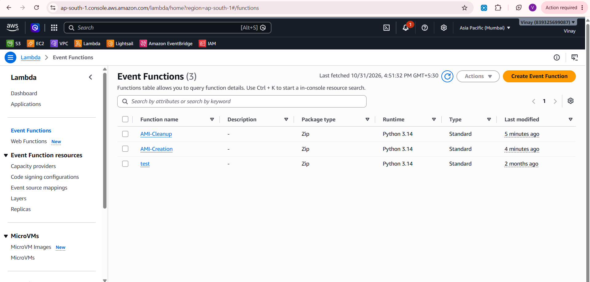
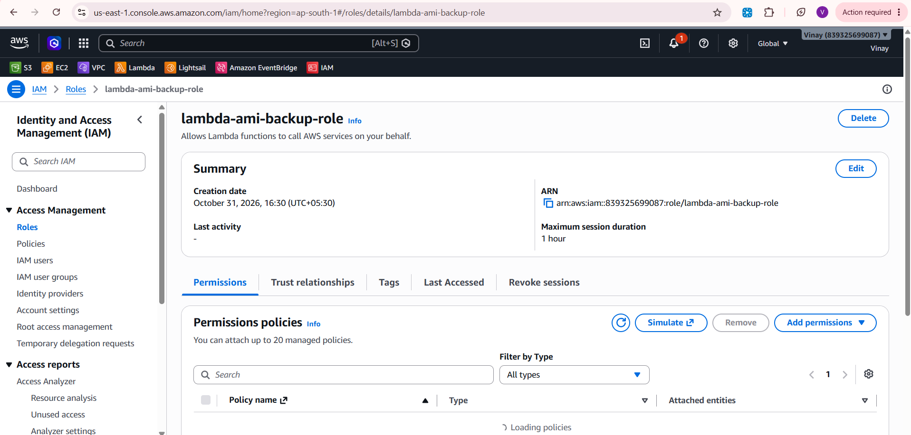
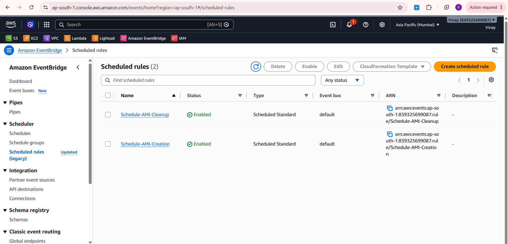

# Automated AMI Creation and Cleanup on AWS

An AWS automation project that creates **Amazon Machine Images (AMIs)** of an EC2 instance on a schedule and deletes AMIs older than a retention period. It uses **AWS Lambda** (Python/boto3), **Amazon EventBridge** schedules, and an **IAM role** for permissions.

---

## Table of Contents

- [Project Overview](#project-overview)
- [Architecture](#architecture)
- [Services Used](#services-used)
- [Prerequisites](#prerequisites)
- [Implementation Steps](#implementation-steps)
- [Screenshots](#screenshots)
- [Outcome](#outcome)
- [Known Limitations](#known-limitations)
- [Security Best Practices](#security-best-practices)
- [Key Learnings](#key-learnings)
- [Author](#author)

---

## Project Overview

Regular backups protect against data loss, but old backups pile up. This project automates both sides:

- A Lambda function creates an AMI of a chosen EC2 instance every day.
- A second Lambda function removes AMIs older than the retention period (7 days).
- EventBridge schedules trigger both functions with no manual work.

**Goal:** Automate EC2 backups and reduce manual backup management.

---

## Architecture

```
EventBridge (daily, 2 AM UTC) --> Lambda: AMI-Creation --> EC2 create_image
EventBridge (daily, 3 AM UTC) --> Lambda: AMI-Cleanup  --> EC2 deregister_image
                         Both functions use the IAM role: Lambda-AMI-Backup-Role
```

---

## Services Used

| Service | Purpose |
|---------|---------|
| AWS Lambda | Runs the AMI creation and cleanup code (Python, boto3) |
| Amazon EventBridge | Schedules both functions with cron expressions |
| AWS IAM | Role that gives Lambda permission to manage AMIs and write logs |
| Amazon EC2 | The instance being backed up, and the AMIs |
| Amazon CloudWatch Logs | Function logs |

---

## Prerequisites

- An active AWS account
- A running EC2 instance to back up (instance ID: `<i-xxxxxxxxxxxxxxxxx>`)
- Region used: `<e.g. ap-south-1>`
- Basic knowledge of Python

---

## Implementation Steps

### Step 1: Create the IAM role for Lambda
1. Go to **IAM → Roles → Create role**.
2. Trusted entity: **AWS service → Lambda**.
3. Attached policies:
   - `AmazonEC2FullAccess`
   - `AWSLambdaBasicExecutionRole`
4. Role name: `Lambda-AMI-Backup-Role`.

### Step 2: Create the AMI creation function
1. Go to **Lambda → Create function → Author from scratch**.
2. Name: `AMI-Creation`, runtime: Python 3.x, execution role: `Lambda-AMI-Backup-Role`.
3. Code:

```python
import boto3
import datetime

ec2 = boto3.client('ec2')

def lambda_handler(event, context):
    instances = ['i-xxxxxxxxxxxxxxxxx']  # Replace with your instance IDs
    date = datetime.datetime.now().strftime("%Y-%m-%d")

    for instance in instances:
        response = ec2.create_image(
            InstanceId=instance,
            Name=f"AMI-Backup-{instance}-{date}",
            Description="Automated AMI Backup",
            NoReboot=True
        )
        print(f"AMI {response['ImageId']} created for instance {instance}")

    return "AMI Creation Completed"
```

4. Click **Deploy**.

### Step 3: Schedule AMI creation
1. Go to **Amazon EventBridge → Rules → Create rule**.
2. Name: `Schedule-AMI-Creation`, type: **Schedule**.
3. Cron expression: `cron(0 2 * * ? *)` (daily at 2 AM UTC).
4. Target: Lambda function `AMI-Creation`.

### Step 4: Create the AMI cleanup function
1. Create a new function named `AMI-Cleanup` (Python 3.x, same role).
2. Code:

```python
import boto3
import datetime

ec2 = boto3.client('ec2')

def lambda_handler(event, context):
    retention_days = 7  # Change as needed
    delete_before = datetime.datetime.now() - datetime.timedelta(days=retention_days)

    images = ec2.describe_images(Owners=['self'])['Images']

    for image in images:
        creation_date = datetime.datetime.strptime(
            image['CreationDate'], "%Y-%m-%dT%H:%M:%S.%fZ"
        )
        if creation_date < delete_before:
            ec2.deregister_image(ImageId=image['ImageId'])
            print(f"Deleted AMI {image['ImageId']}")

    return "Old AMIs Deleted"
```

3. Click **Deploy**.

### Step 5: Schedule the cleanup
1. Create the rule `Schedule-AMI-Cleanup` (type: **Schedule**).
2. Cron expression: `cron(0 3 * * ? *)` (daily at 3 AM UTC).
3. Target: Lambda function `AMI-Cleanup`.

### Step 6: Verify
- `<Describe what you checked, for example: "Ran a manual test of AMI-Creation and confirmed a new AMI appeared under EC2 → AMIs.">`
- Delete this section if you did not verify anything.

---

## Screenshots

### Lambda functions
The `AMI-Creation` and `AMI-Cleanup` functions.



### Backup IAM role
The role `Lambda-AMI-Backup-Role` used by both functions.



### EventBridge scheduled rules
The daily schedules that trigger the functions.



---

## Outcome

- `AMI-Creation` creates an AMI of the specified EC2 instance on a daily schedule.
- `AMI-Cleanup` deregisters AMIs older than the retention period (7 days).
- EventBridge runs both functions automatically, which removes manual backup work.

---

## Known Limitations

Documented honestly so they can be improved:

- **Snapshots are not deleted.** `deregister_image` removes the AMI only. The EBS snapshots created with it remain and still incur storage cost, so they need to be deleted separately.
- **Cleanup scope is too wide.** The function considers every AMI owned by the account, not only the ones created by this automation. Filtering by name prefix (`AMI-Backup-`) or by tag would make it safe.
- **Over-broad permissions.** `AmazonEC2FullAccess` grants far more than needed. A custom policy limited to `ec2:CreateImage`, `ec2:DescribeImages`, `ec2:DeregisterImage`, `ec2:DeleteSnapshot` and `ec2:DescribeSnapshots` follows least privilege.
- **`NoReboot=True` creates crash-consistent images.** Data still in memory or mid-write may not be captured.
- **Hard-coded instance ID.** Using tags to select instances would scale better.

---

## Security Best Practices

- Follow least privilege instead of full-access managed policies.
- Never commit access keys or secrets to this repository.
- Test with a non-production instance first.
- Review CloudWatch Logs after scheduled runs.
- Set a sensible Lambda timeout and monitor costs.

---

## Key Learnings

- Writing Lambda functions with boto3 to manage AWS resources
- Scheduling serverless jobs with EventBridge cron expressions
- Using IAM roles to give a service permissions
- How AMIs and EBS snapshots relate, and why deleting one does not delete the other

---

## Author

**Vinay**
GitHub: [Vinay-PR-Gowda](https://github.com/Vinay-PR-Gowda)
